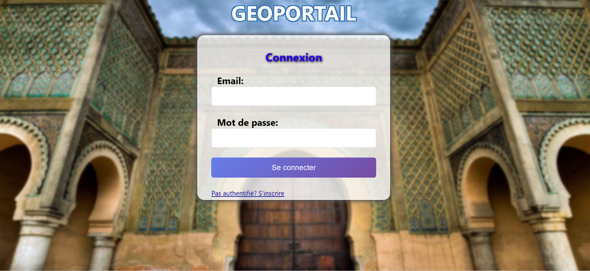
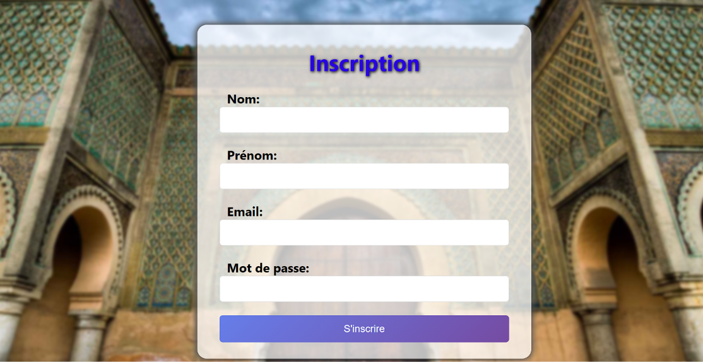
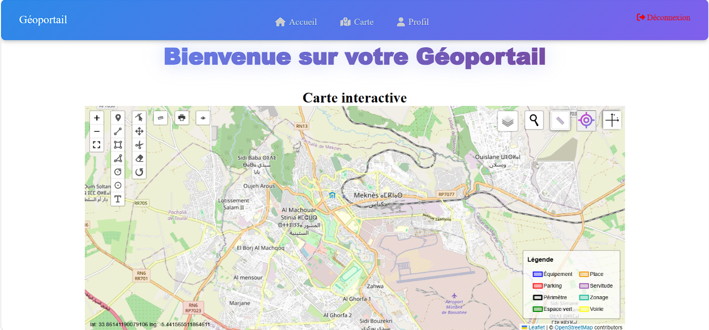
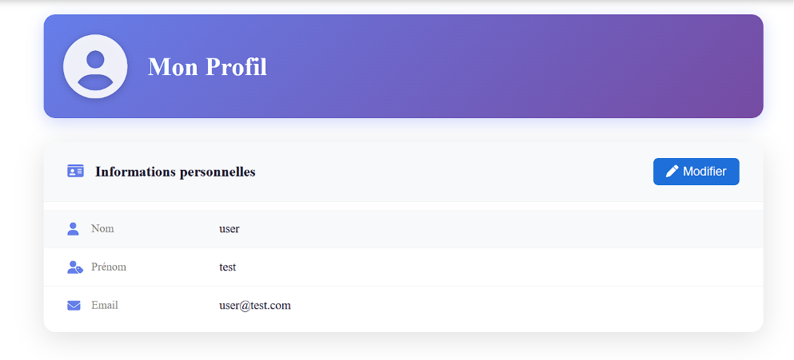
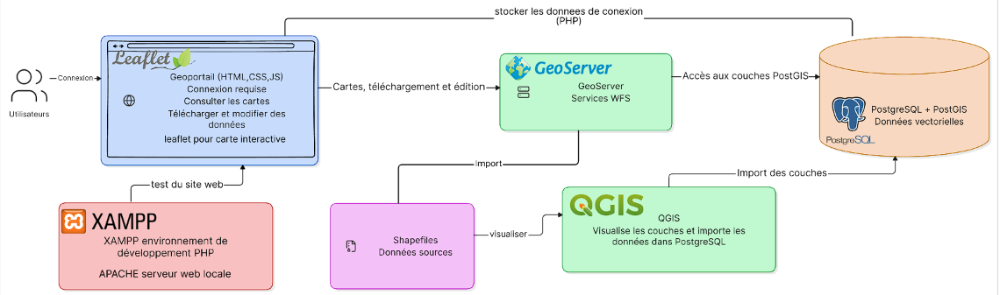

**🌍 Géoportail — Agence Urbaine de Meknès**

Un géoportail web interactif développé durant mon stage ouvrier de première année du cycle ingénieur à l'Agence Urbaine de Meknès.

L'application permet la consultation, la manipulation et la visualisation de données géographiques via une carte interactive, avec un système d'authentification sécurisé.

**🔐 Authentification et gestion des utilisateurs**

\- Page d'authentification :création de compte avec nom, prénom, email et mot de passe,

stocke les informations dans la base de données PostgreSQL à l'aide de PHP, puis redirige vers la page de connexion.

\- Page de connexion : demande l'email et le mot de passe, les vérifie dans la base de données avec PHP, puis crée

une session et redirige vers la page principale.

\- Gestion de session : protection des pages accessibles uniquement aux utilisateurs connectés

\- Page de profil : consultation et modification des informations personnelles + ajout d'une photo de profil

&#x20;**🗺️ Carte interactive**

La page principale intègre une carte interactive développée avec Leaflet JS, connectée à GeoServer pour le chargement des couches géographiques. Elle offre les fonctionnalités suivantes :

* Des fonctionnalités que j'ai juste importer de la bibliotheque des plugins de leaflet :

1\. Full screen : un plugin pour afficher la carte en plein écran.

2\. Geoman : un plugin de dessin des formes (ligne, polygone, rectangle, marker et cercle). Il permet aussi la modification et le déplacement de ces dessins, ainsi que l'ajout de textes.

3\. Mesure linéaire : plugin pour mesurer les distances.

4\. Impression : plugin pour imprimer une partie de la carte.

5\. Geocoder : plugin pour chercher des localisations par nom.

6\.  Layer control : plugin qui change le fond de carte utilisé (OpenStreetMap, Google

Street ou Google Satellite).

7\. Légende : donne des informations sur les couches ajoutées sur la carte.

* le reste des fonctionnalités je les ai développé moi-même en JavaScript à l'aide de l'option de Leaflet qui permet d'ajouter des contrôles et des boutons à la carte:

8\. Localisation : contrôle qui permet d'afficher votre emplacement actuel.

9\. Recherche par coordonnées métriques : permet de rechercher une localisation par ses coordonnées métriques x, y.

10\. Mesure des aires :  mesurer les aires et les distances des côtés des formes dessinées.

11\. Coordonnées de la souris : affichage des coordonnées de la souris en temps réel.

12.Contrôle caché/affiché : permet de cacher tous les contrôles pour avoir une vue simple de la carte

Dans scripts/layers.js j'ai coder une fonction qui affiche des couches depuis geoserver (new L.WFS()), affiche  ses informations attributaires et l'ajoute a la legende , il suffit de changer le contenue de wfsLayersConfig en declarant les parametres necessaire entre accolades (name , typename,stye , popupfields)

* Outils Utilisés

&#x20;Front-end: HTML, CSS, JavaScript

&#x20;Back-end: PHP

&#x20;Base de données:  PostgreSQL (PostGIS)

&#x20;Serveur cartographique: GeoServer (WFS)

&#x20;Bibliothèque cartographique: Leaflet JS

&#x20;Environnement de développement: XAMPP (Apache)

&#x20;Éditeur de code: VS Code

📂 Structure du projet

Geoportail AUMK/
│

├── auth.html

├── logpage.html

├── main.php

├── profil.php

├── update\_profil.php

├── logout.php

├── README.md

│

├── PHP/

│   ├── auth.php

│   ├── config.php

│   └── login.php

│

├── scripts/

│   ├── auth.js

│   ├── controls.js

│   ├── layers.js

│   ├── login.js

│   └── script.js

│

├── styles/

│   ├── main.css

│   ├── profil.css

│   └── style.css

│

├── pluggins/

│   ├── css/

│   │   ├── leaflet-measure-path.css

│   │   ├── leaflet.legend.css

│   │   └── Leaflet.LinearMeasurement.css

│   │

│   └── js/

│       ├── L.Geoserver.js

│       ├── leaflet-measure-path.js

│       ├── leaflet.browser.print.min.js

│       ├── leaflet.legend.js

│       └── Leaflet.LinearMeasurement.js

│

├── medias/

│   ├── background-image.jpg

│   ├── localisation.jpg

│   └── searchcord.webp

│

└── uploads/

   └── profiles/

\## ⚙️ Installation et configuration

&#x20;Prérequis

\- XAMPP (Apache )

\-PostgreSQL avec l'extension PostGIS

\-Geoserver installé et configuré

\### Étapes d'installation

1\Cloner le dépôt
git clone https://github.com/yahyar02/Geoportail.git
Configurer la base de données

Créer une base de données PostgreSQL

Activer l'extension PostGIS : CREATE EXTENSION postgis;

script SQL :

CREATE TABLE utilisateurs (

&#x20;   id SERIAL NOT NULL PRIMARY KEY,

&#x20;   Nom VARCHAR(50) NOT NULL,

&#x20;   Prenom VARCHAR(50) NOT NULL,

&#x20;   email VARCHAR(100) UNIQUE NOT NULL,

&#x20;   mot\_de\_pass VARCHAR(255) NOT NULL,

&#x20;   Photo VARCHAR(255);

&#x09;);

Configurer la connexion

Ouvrir config/config.php

Renseigner les paramètres de connexion;

Configurer GeoServer

Créer un workspace

Ajouter un entrepôt

Publier les couches géographiques

Activer les CORS dans les paramètres de GeoServer

renseigner les couches que tu veux publier avec leurs parametres dans scripts/layers.js

Démarrer Apache depuis XAMPP

placer les fichier dans XAMPP/htdocs

Accéder à http://localhost/login.html

🎮 Démo

Une version statique de démonstration est disponible ici : [Voir la démo](https://yahyar01.github.io/Geoportail/index.html)

📸 Captures d'écran

page de connexion 

page d'authentification

Page principale — Carte interactive

Page de profil

structure du projet 

👤 Auteur

RAMI Yahya

Étudiant en 1ère année du cycle ingénieur — ISSIC

Stage effectué à l'Agence Urbaine de Meknès

📄 Licence

Ce projet a été réalisé dans un cadre académique. Tous droits réservés.

Remerciements

Je tiens à remercier l'ensemble du personnel de l'Agence Urbaine de Meknès pour leurs encadrement  et conseils.

